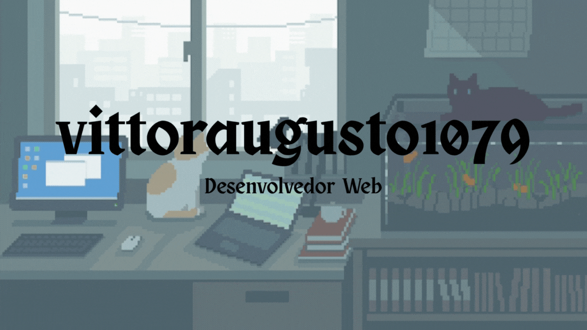

  

  

  
  

<h2 align="center">Sobre Mim</h2>

  
<b>Estudante de Desenvolvimento de Sistemas no SENAI</b>

  

    Sou um grande entusiasta da criação de páginas web. Meu principal objetivo é desenvolver projetos
    com um código bem estruturado e um design autêntico, que se destaque dos demais.
  

<h2 align="center">Ferramentas e Tecnologias</h2>

  

 

<h2 align="center">Estatísticas do GitHub</h2>

  
  

  
  

 

  
<b>Gráfico de atividade</b>

   
  

  
<b>Troféus</b>

   
  

 

  <picture>
    <source media="(prefers-color-scheme: dark)" srcset="https://raw.githubusercontent.com/vitoraugusto1079/vitoraugusto1079/output/snake-dark.svg" />
    <source media="(prefers-color-scheme: light)" srcset="https://raw.githubusercontent.com/vitoraugusto1079/vitoraugusto1079/output/snake.svg" />
    
  </picture>

<h2 align="center">Redes de Contato</h2>

  
  
  
  

 

